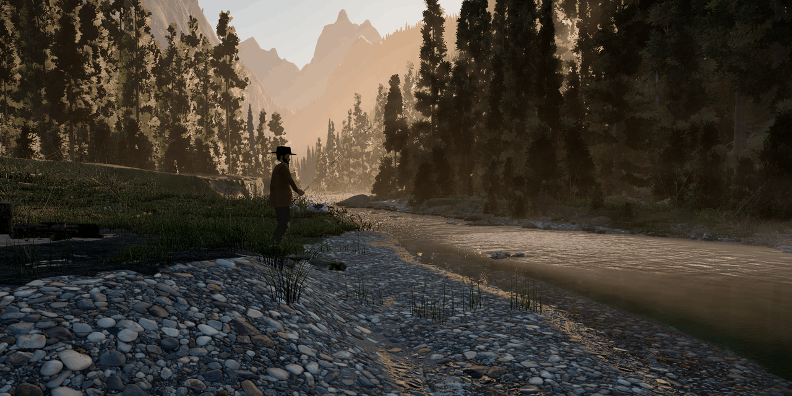

# River Morning

A quiet morning of fishing by a clear mountain river, built in three.js with WebGPU. You are a lone angler on a
gravel bar below a log cabin: walk the bank, cast a float into the deep pool or the riffle, wait for a trout to take
it, play the fish on a split-cane rod, then lift it out of the water, look at it and let it go. There is nothing to
win; the only tally is how many fish you caught and the biggest one. The aim is the look and pace of Red Dead
Redemption 2's quiet moments: a low sun through mist and conifers, a campfire with a coffee pot, a cabin you can walk
into, four times of day from dawn to a moonlit night, and above all the river itself, clear enough to see the stones
and the trout under the surface.



**Play it: https://starknightt.github.io/river-morning/**

It needs a browser with WebGPU, a keyboard and a mouse; Chrome or Edge is recommended. It was built in Chrome on
Windows and measured on an RTX 4060 at 1920x1080. The graphics setting starts on Auto, which picks a quality preset
for your GPU and screen size, and on integrated graphics the loading screen suggests switching the browser to the
high-performance GPU. **The first visit downloads about 94 MB before it can start**, which took about a minute on the
connection it was tested on (about 136 MB in all once the other three skies and the sounds have loaded in the
background). Once the files are in, the test PC needed about 12 seconds to decode them and compile the shaders. The
browser keeps the files, so later visits skip the download: a second visit was playable in about 14 seconds.

## Running it locally

```
git clone https://github.com/StarKnightt/river-morning.git
cd river-morning
pnpm install
pnpm dev        # http://127.0.0.1:5173
pnpm build      # type-check, then a production build into dist/
pnpm preview    # serve dist/ on http://127.0.0.1:4173
```

You need Node.js 22 and pnpm 10 (`package.json` pins the version). The only runtime dependency is `three`
(r186.1); the game is TypeScript built with Vite. The dev server's port is fixed: if 5173 is taken it stops with an
error instead of picking another. The build uses a relative base, so `dist/` works from any sub-path. Every push to
`master` builds the site and deploys it to GitHub Pages through `.github/workflows/pages.yml`.

## Controls

Click the scene once to capture the mouse. The game's buttons count only while the mouse is captured, and the click
that captures it never casts.

| Input | Action |
|---|---|
| Mouse | Look around |
| W A S D / arrow keys | Walk, relative to the camera. He wades up to about 40 cm deep and steps up onto the dock and the porch |
| Shift | Walk faster (a brisk walk; there is no run) |
| Left button or Space, held | Aim: he turns to where you look and draws the rod back while a power bar fills for about a second, and a dotted track on the water ends in a ring where the float will land (cream on fishable water, brick red elsewhere). Release to cast |
| Right button or R, while aiming | Cancel the cast (Esc also cancels) |
| Left button or Space, at a bite | Hook the fish. When the float is pulled under and the prompt says "LMB to hook!", strike at once: a trout lets go of the bait after about a second |
| Right button or R, held | Reel. With nothing on, it reels the float in. In a fight, ease off when the prompt turns red: reeling against a run snaps the line, while the reel's drag gives line safely when you are not reeling. A slack line for a few seconds can let the trout throw the hook |
| E | Put the rod down on dry ground or the dock beside him and walk hands-free (if the float is out and nothing is biting, he reels in first). Back near the rod and facing it, E picks it up. Within about 1.5 m of the cabin door and facing it, E opens or closes it |
| T | Next time of day: dawn, morning, golden hour, night. Each change fades over about 2 s |
| Tab, held | The catch tally: fish caught and the biggest one. It also shows for a few seconds after each catch |
| Esc | Free the mouse and pause: the graphics setting, the GPU in use and a Credits link. Esc again, or a click on the scene, resumes |

Landing is automatic: bring a tired trout close, or into the shallows, and he lifts it, holds it up for a few seconds
with a card showing the species, length and weight, then kneels in the water and lets it go. He stands still while the
float is out, so reel in (or press E) to walk on. The deep pool in front of the dock is the best water; the riffle
upstream is narrow, so cast softly there. A float that lands on the bank gets no bites, and striking with nothing on
only spooks the fish. Sound starts with the first click or key press (a browser rule), and there is no volume control
in the game; use `vol=` or `audio=0` below.

| URL option | Effect |
|---|---|
| `tod=dawn` | Starts at `dawn`, `morning` (default), `golden` or `night`. The address follows the T key |
| `quality=low` | The graphics preset for this visit: `low`, `medium`, `high`, `ultra` or `auto` (not saved) |
| `backend=webgl` | WebGL 2 instead of WebGPU (on Low unless `quality=` says otherwise) |
| `scale=0.75` | Render scale, as a fraction of the width and height; it also turns the resolution governor off |
| `gov=0` | No resolution governor: the render scale stays at full |
| `sharpen=0.3` | Contrast-adaptive sharpening after anti-aliasing, 0 to 1. Off by default: it can make the needles shimmer in motion |
| `vol=0.5`, `audio=0` | Starting volume, 0 to 1 (not saved); no sound at all |
| `fishfast` | Bites come about five times sooner |
| `grass=0`, `trout=0`, `fish=0` | No grass; no trout in the river (bites then come from simpler stand-in fish); no fishing at all |
| `shot=C1` | Photo mode at a fixed camera spot, `C1` to `C6`: no HUD, no sound, time frozen, graphics on High. C1 the gravel bar looking upstream, C2 a clear-water close-up, C3 the riffle from the south bank, C4 the dock tip across the pool, C5 the water's edge looking up to the camp, C6 an overview |
| `cam=x,y,z,tx,ty,tz` | Camera position and look-at point in metres (y is up; the pool's surface is y = 0). With `shot=` it gives a still, with `fly` a start view |
| `fly` | A free camera instead of the angler: click to capture the mouse, W A S D to fly, E or Space up, Q or C down, Shift faster |
| `debug` | A panel at the top left: renderer, GPU, fps, frame times, render scale and camera position |
| `nopost` | No post-processing |

Join several with `&`, for example `?tod=golden&quality=ultra`. The A/B switches used while building (`water=0`,
`trees=0`, `mist=0` and more) are listed in `src/core/params.ts`.

### Graphics quality

The pause menu (Esc) offers **Auto** (the default), **Low**, **Medium**, **High** and **Ultra**. Auto first guesses
from the GPU's name, then measures a few seconds of play and keeps the highest preset that holds 60 fps at your window
size; the result is remembered for that GPU, and the menu shows what Auto picked. A preset you choose yourself is
remembered too. Changing the setting restarts the game. **High** is the look everything was tuned and measured at.

| | Low | Medium | High | Ultra |
|---|---|---|---|---|
| Most pixels drawn | 1280 x 720 | 1920 x 1080 | 2560 x 1440 | 3840 x 2160 |
| Sun shadow map | 1024 | 2048 | 2048 | 4096 |
| Ambient occlusion | off | off | half resolution | full resolution |
| Mist | lowest resolution | half resolution | half resolution | full resolution |
| Pool reflection | sky only | lower resolution | on | sharper, refreshed more often |
| Light and caustics on the river bed | off | on | on | on |
| Grass and forest detail distance | about 60 % | about 80 % | 100 % | about 125 % |

Bloom and anti-aliasing stay on in every preset; the lower presets also redraw the sun's shadows and the pool's
reflection less often. Without WebGPU the game switches to WebGL 2 by itself and runs on Low (the loading screen says
so), and with neither it lists the browsers that work.

## What is in it

- **The river.** A riffle of standing waves and white water round mossy boulders pours into a deep, calm pool and runs
  out over a gravel tail. The water is clear: you see the cobbles and the trout through it, a net of sunlight moves
  over the stones, and the deep water sinks into dark emerald. The calm pool mirrors the forest and the sky, the low
  sun lays a glitter of sparkles on it, and floats, fish and hands leave rings, splashes and droplets.
- **Mist and light.** Morning mist lies on the water in sheets and wisps and lifts off in plumes, the sun comes down
  between the trunks in shafts, and the valley fades into blue haze toward the snow peaks.
- **The forest and the meadow.** About 6,800 conifers in 15 variants swaying in the wind, a carpet of tree cards on the
  valley walls up to the skyline, and a grass sward with tussocks, sedge, horsetail and wildflowers, ferns, fallen
  trunks, stumps and scanned rocks.
- **43 trout** of four species (brown, rainbow, brook and cutthroat). They hold in the current facing upstream, cruise
  the pool, rise to feed, bolt from you and from splashes and drift back later, and inspect the float before they take.
- **Fishing.** Cast with a power bar and a landing marker, wait for the bite, strike, then play the fish against the
  line's breaking point and the reel's drag. He lands it, shows it with its species, length and weight, kneels and
  lets it go, and the tally keeps the count and the biggest fish.
- **The rod put down and picked up.** E lays the rod on the ground or the dock and he walks hands-free; it stays
  where it lies until he comes back for it.
- **The camp and the walk-in cabin.** A log cabin with a fieldstone chimney and a porch, a dock out into the pool, a
  campfire with a coffee pot, a woodpile and a chopping block. The cabin door opens, and he can walk into the room,
  where a lantern lights the table by the river window.
- **Four times of day.** Dawn, morning, golden hour and night, each with its own sky, light, mist and sound; T fades
  from one to the next in about two seconds. At night the moon and the stars come out and show in the pool, and the
  campfire and the cabin window glow.
- **Sound.** The river crossfades between the calm pool and the riffle as you walk the bank. Birds sing by day,
  crickets and an owl take over at night, the wind moves in the pines, the fire crackles and the coffee simmers.
  Footsteps change on gravel, grass and wood, and the cast, the reel, plops, bites and splashes all have their own.

## How it works

### Rendering and the post chain

Everything is drawn with three.js's WebGPURenderer and TSL node materials, with WebGL 2 as a fallback. A cheap normal
and depth pre-pass, at the ambient occlusion's own resolution, feeds GTAO, which only dims indirect light. The scene
pass follows, then the mist, bloom, AgX tone mapping, a light colour grade with a vignette, and SMAA. About 130 shader
pipelines are compiled in parallel behind the loading screen, so nothing stalls once you play.

### Water

The river is one ribbon mesh along the channel with a single material. A field baked at load from the bed and the
rocks holds the current, the depth, the foam trails and the surface relief, and the water, the caustics, the trout and
the sound all read it, so they agree on where the fast water is. In the riffle a second bake places the standing
waves, the water heaped against each rock and the V of its wake, the glassy tongues between rocks, and the white water
where the riffle plunges into the pool, all from the real geometry rather than a texture.

Looking into the water, the bed is refracted through the screen, with per-channel absorption along the real light
path: red goes first, so the shallows keep their colours and the deep pool turns emerald. On the bed a caustic net,
baked once with an FFT, is projected along the refracted sunbeam, blurs with depth and drifts with the current, and
the trout cast crisp shadows through it. The calm pool has a true planar mirror, drawn at reduced resolution into a
back buffer in up to three bands while the water reads the front one, with an oblique near plane adapted to reversed
depth. The sun's reflection is a scatter of sparkles rather than a smooth glare. Splashes and rings are slots in one
list that the water shader loops over, and the droplets of a splash fall back with tiny rings of their own.

### Mist

The mist is a half-resolution post pass. Each pixel's view ray is marched in 12 jittered steps through two media: a
sheet of mist lying on the water, thickest over the calm pool and broken into sheets, gaps and wisps by drifting noise,
and a thin forest aerosol that is lit only where the sun's shadow map lets light through, which is what draws the
shafts between the trunks. A depth-aware filter smooths it without bleeding across edges, and beyond its range an
analytic haze in three height layers takes over.

### Forest and grass

The conifers come in 15 variants with three levels of detail each, grown from ez-tree branch skeletons and dressed
with Poly Haven twig and bark maps. They are repacked into instanced meshes on the CPU whenever the camera moves, with
per-tree culling for the view and for the pool's mirror image. The needle cards use a coverage-preserving alpha test
with a depth twin, so crowns stay full in the distance, and the shadows come from a static set of low-detail casters.
Beyond the instanced trees, camera-facing silhouette cards cover the valley walls. Near the camera the grass is blade
patches and tussocks in 6 m chunks; further out short cards carry the sward to about 36 m.

### The angler

A MakeHuman body in community-made clothes, on a 53-bone game skeleton, animated with CMU motion capture and
Quaternius clips, plus a procedural pose layer for the rod grip, the one-handed cast, braced reeling and holding a
fish. Two-bone IK plants his feet on uneven ground, and his own self-shadow map keeps the shadows on him sharp.

### Fishing and the trout

Fishing runs on a fixed 1/120 s step, so casts, bites and fights behave the same at 60, 144 and 240 Hz. The line is a
verlet rope that sags in the air, lies on the water and drifts with the current. The trout live on the CPU, in holding
lies read from the river field: they cruise, rise, bolt and drift back, inspect and take the bait, and fight with
stamina and runs. They are drawn as two instanced meshes per species and swim in the vertex shader with a travelling
body wave; their skins come from public-domain U.S. government fish paintings.

### Time of day

Each time of day is a prepared Poly Haven sky: the visible sky cropped to the upper hemisphere, a light map with the
sun clamped out, and a small file with the sun's direction, colour and strength measured from the plate. The skies are
decoded in a worker and uploaded once; the first loads before you start and the other three in the background. At
night the game draws its own stars and moon on top of the plate, in the background, so the pool mirrors them too.

### Quality and the governor

Auto guesses a preset from the GPU's name, then measures a few seconds of play and keeps the highest preset that holds
60 fps at your window size. During play a resolution governor watches the GPU's frame time: it lowers the render scale
in small steps when frames stay over budget and raises it only with clear headroom, and on High and Ultra it never
goes below a 1920 x 1080 pixel count. The drawing buffer never exceeds 5120 x 2880. If the GPU device is lost (a
driver reset, for example), the game reloads one preset lower.

### Sound

63 Ogg Vorbis files cut from CC0 and CC BY recordings, mixed with the Web Audio API. The river is a row of point
emitters every 2 m along the bank, each split between a calm and a riffle bed by the real flow speed, so walking the
bank crossfades them where the fast water really is. Birds, crickets and the owl follow the time of day, and the
footsteps follow the surface underfoot.

## Performance

Measured in Chrome on a Ryzen 5 7600X with an RTX 4060 (8 GB) and 32 GB of RAM, at 1920 x 1080 on High. At the fixed
camera spots, the fishing moments, the play views and inside the cabin, by day, at golden hour and at night, the GPU
takes about 10 to 13.5 ms per frame on average and 11 to 14 ms at the 95th percentile: 60 fps with some headroom. The
busiest water views, low over the riffle and over the pool head, are the exception. They sit on or just over 14 ms at
the 95th percentile, and reached about 15 ms with a video playing on the same GPU: still inside the 16.7 ms of a 60 fps
frame, but with little to spare. Above 100 fps the shadow and reflection refreshes are spaced out, and walking,
fishing and the trout behave the same at 60, 144 and 240 Hz.

A first visit to the live site downloads about 94 MB before the game can start (118 MB of files; GitHub Pages
compresses most of them on the way): the morning sky, the terrain textures, the trees, rocks and camp models, the
angler and 0.6 MB of code. The largest downloads are the four sky backgrounds (6.6 to 11.4 MB each), the cabin
(6.1 MB) and the angler (4.5 MB). The other three skies (34 MB) and the 63 sounds (9 MB) follow in the background,
about 136 MB in all. On the connection it was tested on, the first visit was playable after about a minute; from a
local copy of the build, with no download time, it took 13 seconds, nearly all of it decoding and shader compilation.

## Project structure

```
src/
  core/       renderer and post chain, quality presets and Auto, resolution governor, GPU guard, asset loading,
              URL switches, shader warm-up
  world/      terrain, river path, sky light, time of day, fog and mist, forest and far forest, grass, bank props,
              the fallen spruce, night sky and lights
  water/      river surface and material, flow and riffle bakes, pool mirror, underwater light and caustics,
              rocks, splashes, shoreline
  camp/       cabin with its door and room, dock, campfire with flames and smoke, woodpile, camp ground
  player/     the angler: character, materials, animation, rod rig and putting it down, foot IK, walking, camera
  fishing/    cast, float, line, bites, fight, landing and release, input, the bridge to the sound
  fish/       trout species, habitat, behaviour, material and the school of 43
  audio/      Web Audio engine, river, forest and camp ambience, event bus
  ui/         fishing HUD, time-of-day label, pause and graphics menu
  gfx/        shared shader helpers, the mist filter and sharpening, noise, shadow helpers
  debug/      photo-mode camera spots, free camera, A/B toggles
public/assets/     everything loaded at run time: packed terrain textures, trees, rocks, logs and ferns, the camp,
                   the angler and the rod, the trout, the four skies, the sounds
public/CREDITS.md  the credits, shipped with every build and linked from the pause menu
scripts/           developer checks and tools (below)
tools/             Python asset prep: terrain texture packing, sky preparation
```

The scripts run with `pnpm tsx scripts/<name>.ts`. The browser checks drive the installed Chrome in play mode, muted:
`playcheck` (walking, wading, the dock, the porch, the camp paths), `fishcheck` (casting, bites, fights, landing,
release and a snapped line), `todcheck`, `rodcheck`, `cabincheck`, `robustcheck` (big screens, the governor, GPU
errors) and `qualitycheck`. `pnpm shots` takes screenshots and timings at the fixed camera spots. `fish-sim`,
`fishfight` and `govsim` run headless with no browser or GPU. `pnpm assets:polyhaven` downloads the Poly Haven source
files again into `raw/`, which git ignores. The checks were written for the author's PC: they write under
`E:\shots\river-morning\` unless told otherwise.

## Limitations

- **The riffle views sit near the GPU limit.** On the RTX 4060 at 1080p on High, the views low over the riffle and
  the pool head take 14 to 15 ms of GPU time per frame at the 95th percentile, close to the 16.7 ms of a 60 fps frame,
  so they are the first to drop frames when something else is using the GPU.
- **The moon's glitter is faint.** At night the moon and the stars show in the pool, but the broken column of glitter
  a real moon lays across the water is too faint.
- **The flames are small.** The campfire burns low under the coffee pot, and its flames read small.
- **The far mountains look flat.** The distant peaks are a terrain ring with rock and snow textures in haze; they
  have little relief or detail of their own.
- **Weak integrated graphics get very low frame rates.** On the test PC's own small Radeon GPU the game ran at about
  5 fps even on Low. A laptop whose integrated GPU drives the screen may do better; that was not tested.
- **Browsers and hardware.** Only Chrome on Windows 11 with an NVIDIA GPU was tested. Edge uses the same engine;
  Firefox, Safari, macOS, Linux, AMD and Intel GPUs and phones were not tried.
- **The WebGL 2 fallback** is simpler (Low, so no ambient occlusion or pool reflection) and was only lightly tested.
- **Sound** was mixed by measurement, not yet by ear. The files are Ogg Vorbis, so Safari may stay silent.
- **The cabin's indoor light is approximate.** It fades with distance from the door and the windows rather than by
  real occlusion, and the furniture casts no sun shadows. On quick turns indoors, the rod tip can dip into the roof
  boards or a wall.
- **At very high refresh rates** the fishing line and float update at a fixed 120 Hz without interpolation, so at
  144 to 240 Hz they move very slightly unevenly.
- **The first visit is a large download**, about 94 MB before the game starts.

## How it was built

It was built in Cursor by AI agents, in nine parts (terrain and light, water, forest, camp, angler, fishing, fish,
time of day, sound) and a final polish pass. One main agent alone changed the game, while helper agents prepared the
assets (the Poly Haven scans, the angler, the camp models and the rod made in Blender, the trout and the sounds) and
tried out patches in copies of the project. After each part the game was photographed from the same fixed camera
spots, and a separate critic, which saw only those screenshots and real reference photos, listed what looked fake;
the findings went into the next round. The user steered it throughout.

## Licence and credits

The game's own code is MIT. See [LICENSE](LICENSE).

The third-party assets keep their own licences: the Poly Haven scans and skies (CC0), the MakeHuman angler and his
clothes, the CMU motion capture, the Quaternius animations, the sound recordings, the trout illustrations, and the
libraries the game ships with. [CREDITS.md](CREDITS.md) lists each one with its author, source and licence; it also
ships with the game and is linked from the pause menu. Three lines in it must ship with the game: the CC BY 4.0
credits for the angler's boots and two splash sounds, and CMU's motion capture acknowledgement.
